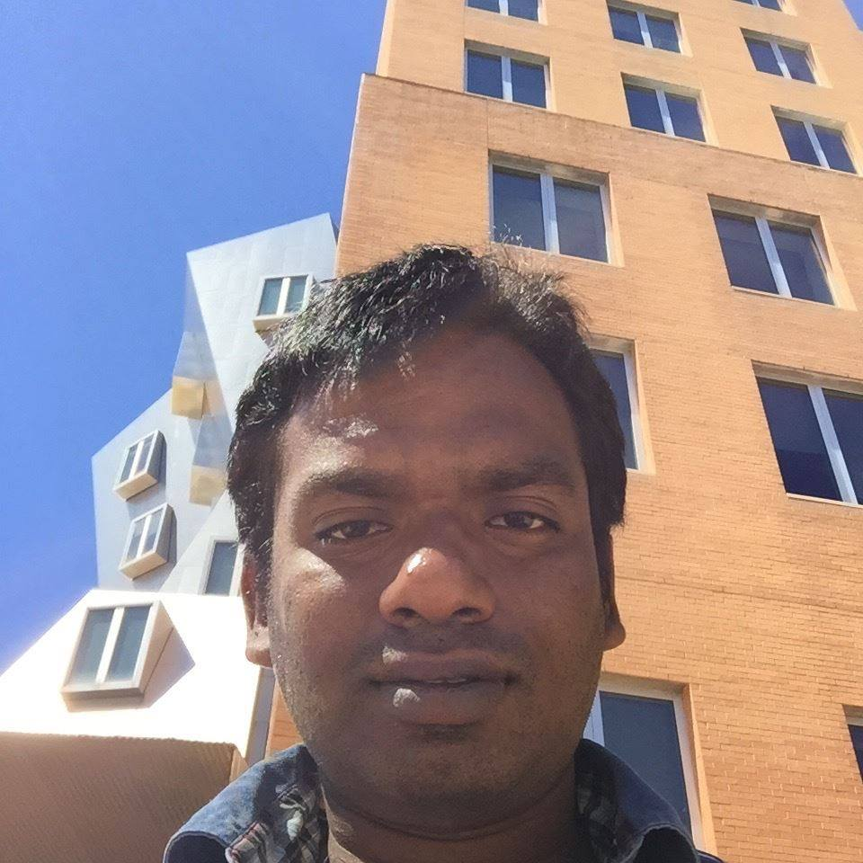

I'm a Research Scientist at Visa Research. In 2025–2026, I led a team evaluating AI agents for reliability, security, and resistance to manipulation, including jailbreaks. I also helped build a lightweight system for coordinating multiple agents and built and tested sandboxes for running them.

In 2024, I researched watermarking for language model outputs and techniques for secure inference. My earlier work in cryptography includes secure multiparty computation, privacy-preserving protocols, and blockchain payment channels.

Before joining Visa, I worked in the Cryptography Group at Microsoft Research and held postdoctoral positions at MIT CSAIL and the Technion. I earned my Ph.D. in Computer Science at the University of Maryland.

I've been fortunate to have [great mentors](/people/#mentors) and have had the pleasure of mentoring many [talented interns](/people/#interns).

I'm fascinated by how neural networks work, which is what draws me to interpretability. I'm especially interested in using it to pinpoint where an agent's trajectory starts to drift from its task, measure that drift, and help the agent get back on track.

  <a href="/files/ranjit_kumaresan_cv.pdf" class="btn btn--primary">Download CV</a> | 
  <a href="/publications/" class="btn btn--primary">Selected Publications</a>

**Contact.**  
<mailto:vranjit@gmail.com> | <a href="{{ site.author.googlescholar | escape }}">Google Scholar</a>
