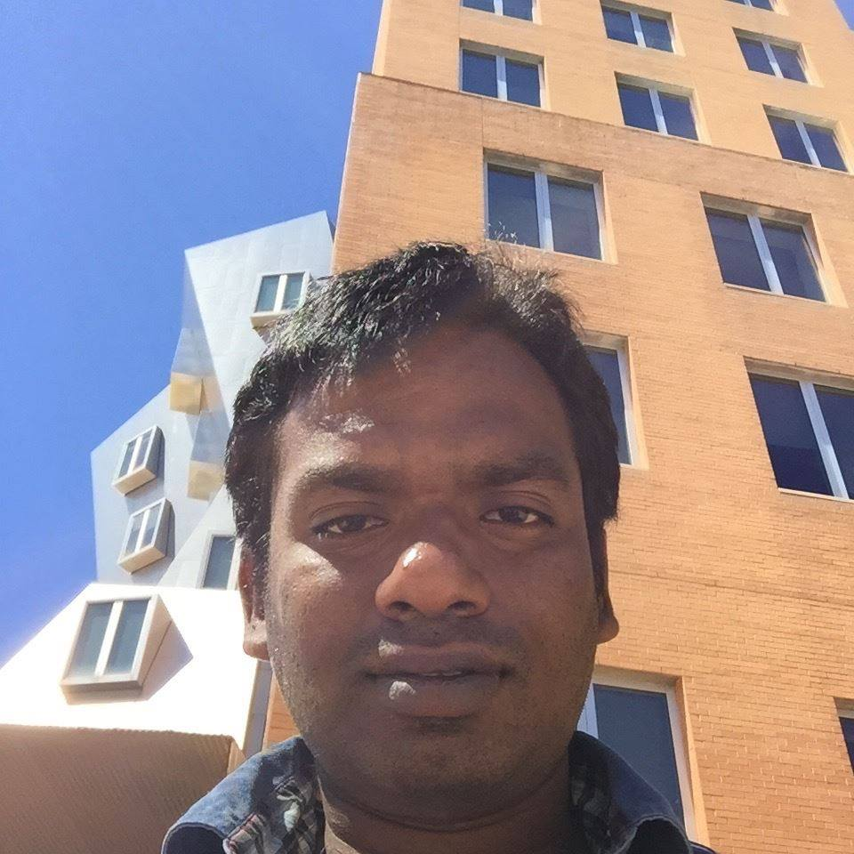

  

    

      <a href="/files/ranjit_kumaresan_cv.pdf" class="btn btn--primary">Download CV</a> | 
      <a href="/publications/" class="btn btn--primary">Selected Publications</a>
    

    
    

      <a href="mailto:vranjit@gmail.com">vranjit@gmail.com</a> | <a href="https://scholar.google.com/citations?user=YC3Ab4oAAAAJ">Google Scholar</a>
    

  

  

    
  

I'm a Research Scientist at Visa Research. I study how to tell when a tool-using AI agent has drifted from its task or reported success without enough evidence. In 2025–2026, I led evaluations of agent reliability, security, and resistance to manipulation.

I'm interested in using GPU-based fine-tuning and reinforcement learning to test whether agents can learn to check uncertain outcomes before reporting success.

In 2024, I worked on watermarking language model outputs and on secure inference. My earlier [publications](/publications/) cover cryptography, secure multiparty computation, privacy-preserving protocols, and blockchain payment systems.

I've been fortunate to have [great mentors](/people/#mentors) and [talented interns](/people/#interns).

  <a href="/about/">About</a> |
  <a href="/publications/">Publications</a> |
  <a href="/files/ranjit_kumaresan_cv.pdf">CV</a> |
  <a href="/files/ranjit_kumaresan_cv_short.pdf">CV (Short)</a>

